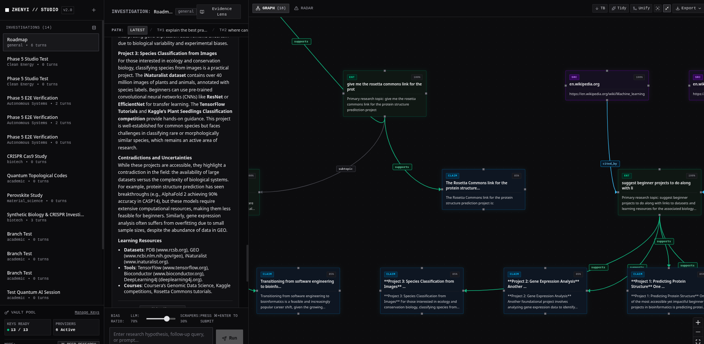
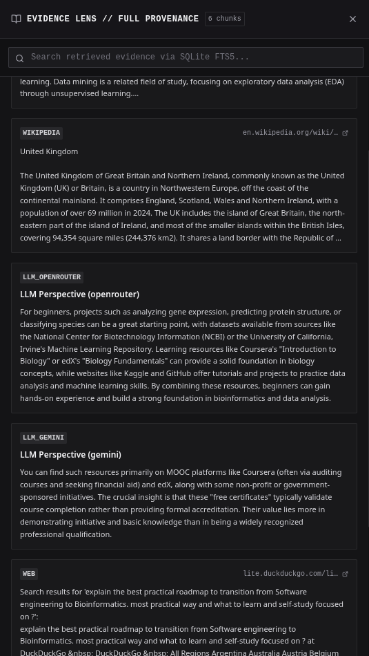

<div align="center">


<br><br>


# Zhenyi

### Autonomous Multi-Agent Research Studio and Knowledge Graph

[](LICENSE)
[](pyproject.toml)
[](server.py)
[](web-ui)

</div>

**Zhenyi** is an open-source, autonomous multi-agent research system that coordinates multiple free-tier LLM providers, collects empirical evidence across web and academic sources, and synthesizes structured findings into an interactive, real-time knowledge graph.

The project is named in honor of **Wang Zhenyi** (1768–1797), an eighteenth-century mathematician and astronomer noted for rigorous empirical observation and scientific inquiry.

---

## Core Capabilities

- **Dynamic Multi-LLM Orchestration**: Dynamically assigns analytical roles (orchestration, triage, multi-perspective analysis, and synthesis) across Google Gemini, Groq, OpenRouter, Cerebras, Cohere, and GitHub Models based on quota availability and domain strengths.
- **Quota-Aware Architecture**: Operates without commercial API billing requirements by leveraging intelligent provider rotation, cooldown tracking, and deterministic fallback routines.
- **Multimodal Data Collection**: Integrates 9 built-in scrapers covering HackerNews, arXiv, Wikipedia, DuckDuckGo, YouTube, SEC EDGAR, OpenAlex, and Open-Meteo.
- **Hierarchical Triage and Resiliency**: Applies heuristic and LLM-based scoring filters to reject low-relevance content, paired with circuit breakers that isolate unstable upstream sources.
- **Interactive Knowledge Graph**: Provides a configurable force-directed graph canvas that extracts cross-entity relationships in real time alongside a resizable studio interface.
- **Auditable Lineage**: Preserves full execution traces (`thought_chain`, `agent_outputs`, and citations) in an embedded SQLite database.

---

## Architecture

Zhenyi processes incoming research queries through a sequential five-stage pipeline:



For a comprehensive explanation of pipeline stages, role scheduling, and failure recovery protocols, refer to **[ARCHITECTURE.md](ARCHITECTURE.md)**.

---

## Quickstart

### 1. Environment Preparation

```bash
git clone https://github.com/ShamalLakshan/zhenyi.git
cd zhenyi

python3 -m venv .venv
source .venv/bin/activate  # On Windows: .venv\Scripts\activate

pip install -r requirements.txt
```

### 2. Configuration

```bash
cp .env.example .env
```

Populate `.env` with provider API keys. Google Gemini is recommended as the baseline orchestrator:

```env
GEMINI_KEY_1=your_gemini_api_key
GROQ_KEY_1=your_groq_api_key
OR_KEY_1=your_openrouter_api_key
```

### 3. Execution

```bash
uvicorn server:app --reload --host 0.0.0.0 --port 8000
```

Access the web interface at **[http://localhost:8000](http://localhost:8000)**.

---

## User Interface

<div align="center">
<table>
  <tr>
    <td></td>
    <td></td>
  </tr>
  <tr>
    <td></td>
    <td></td>
  </tr>
</table>
</div>

---

## Supported Providers and Scrapers

### Supported LLM Providers

| Provider | Default Role | Typical Free Tier Allocation |
|---|---|---|
| **Google Gemini** | Orchestrator and Deep Analysis | 1,000 requests / day |
| **Groq** | High-Speed Triage and Filtering | 14,400 requests / day |
| **OpenRouter** | Multi-Angle Reasoning and Synthesis | ~200 requests / day |
| **Cerebras** | High-Throughput Inference | 14,400 requests / day |
| **Cohere** | Synthesis and RAG Summarization | 1,000 requests / day |
| **GitHub Models** | Fallback Analytical Inference | 150 requests / day |

### Built-in Scrapers

- **hackernews**: Technology discussions and technical commentary
- **arxiv**: Academic preprints and scientific literature
- **wikipedia**: Encyclopedic articles and contextual reference
- **web / ddgs**: Real-time web index queries via DuckDuckGo
- **youtube**: Video transcripts, descriptions, and metadata
- **sec_edgar**: Financial filings and corporate disclosures (US)
- **openalex**: Scientific publication citations and scholarly metadata
- **open_meteo**: Historical and forecast meteorological records

---

## Documentation

Comprehensive project documentation is available in the repository root:

- **[Architecture Guide](ARCHITECTURE.md)**: Detailed system design, pipeline life cycle, and component interactions.
- **[API Reference](API.md)**: Specifications for REST endpoints and WebSocket protocols.
- **[Contributing Guide](CONTRIBUTING.md)**: Developer setup, scraper and provider authoring, coding standards, and pull request procedures.
- **[Security Policy](SECURITY.md)**: Credential isolation, threat model, and vulnerability reporting process.
- **[License](LICENSE)**: Complete terms of the Apache License 2.0.

---

## License

Zhenyi is distributed under the terms of the [Apache License 2.0](LICENSE).
